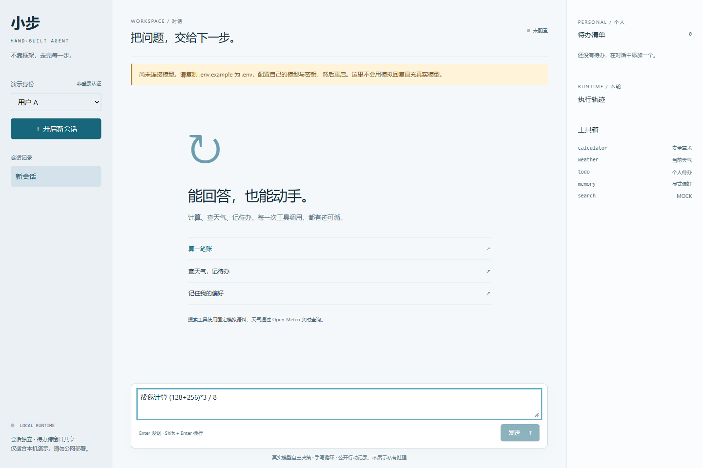
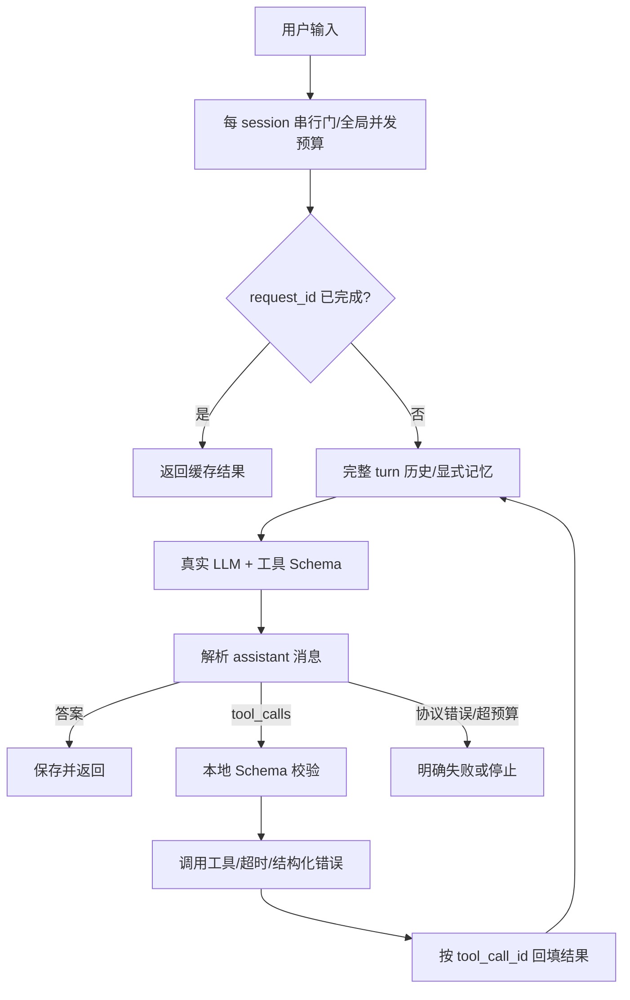

# 小步 · Minimal Agent

从零实现：**手写 Agent Runtime、真实 LLM HTTP 适配器、工具注册与 Schema 校验、SQLite 会话/个人记忆、本地浏览器 UI**。没有 LangChain、LangGraph、OpenHands 或 OpenClaw 依赖。

> **交付状态（2026-10-21）：真实 LLM 端到端验收已通过。** 用户在本地配置后，真实模型测试 1 passed（8.77 秒），覆盖自主计算、待办写入、显式记忆与跨会话召回；离线 36 项测试及 GitHub CI 已通过。正式入口只连接真实模型，未配置就报错，不静默降级。此结果只证明当前配置和验收用例，不代表所有供应商/输入都已验证。



## 运行

Python 3.11+，推荐 3.13。从仓库根目录运行：

```powershell
git clone https://github.com/27adadadad/xiaobu-minimal-agent.git
cd xiaobu-minimal-agent
python -m venv .venv
.\.venv\Scripts\python -m pip install -r requirements-lock.txt
.\.venv\Scripts\python -m pip install -e . --no-deps
Copy-Item .env.example .env
```

本地编辑 `.env`，填写自己的 `LLM_API_KEY`、`LLM_BASE_URL`、`LLM_MODEL`。基础地址示例为 `https://api.openai.com/v1`，**不要**加 `/chat/completions`。模型必须是账号可用且支持原生工具调用的型号，不猜测默认型号。不要把密钥放进前端、聊天、截图或 Git。

```powershell
.\.venv\Scripts\python -m minagent
```

浏览器打开 **http://127.0.0.1:8000**。修改配置后重启。换端口：`python -m minagent --port 8001`。macOS/Linux 使用 `.venv/bin/python` 和 `cp .env.example .env`。

## 演示输入

1. `你好，解释什么是 Agent。` → 普通问题直接回答。
2. `帮我计算 (128+256)*3/8。` → calculator → 144 → 模型回答。
3. `查上海当前天气，再添加待办：出门前检查雨伞。` → weather → todo → 最终回答。
4. `列出我的待办。`；随后 `把编号 1 的待办标记完成。` 或 `删除编号 1 的待办。`
5. `请长期记住：我的常住城市是上海。`；新会话问 `我的常住城市是哪里？`
6. 用户 A 新会话：历史独立，待办/长期偏好共享。切到 B：看不到 A 的数据。

这是验收输入，不是伪造的真实模型运行记录。`tests/ui_fixture.py` 仅用于离线浏览器测试，明确标注 **OFFLINE UI FIXTURE — NOT REAL LLM**，正式入口不加载它。

## 系统设计



核心在 [`Runtime.loop`](minagent/runtime.py)，不是关键词路由。模型收到注册工具的真实 Schema，自主决定返回 `tool_calls` 还是普通答案。

| 文件 | 职责 |
|---|---|
| `minagent/runtime.py` | decide → dispatch → observe → decide；串行、取消、预算、幂等 |
| `minagent/llm.py` | httpx 真实 Chat Completions HTTP；有限重试 |
| `minagent/protocol.py` | 工具 ID/名称/JSON 参数或最终文本解析 |
| `minagent/tools.py` | 名称、描述、JSON Schema、函数注册与参数校验 |
| `minagent/store.py` | SQLite 会话、待办、记忆、回执和重启恢复 |
| `minagent/prompts.py` | 实际系统提示词 |
| `minagent/web.py` | 本机 HTTP/SSE 传输，不负责模型决策 |
| `web/` | 原生 HTML/CSS/JS，无构建步骤或远程资源 |

### 工具

| 工具 | 实现与边界 |
|---|---|
| calculator | 本地真实计算；AST 白名单，禁止 eval、函数/属性调用、超预算表达式 |
| search | **明确 MOCK**：固定 Agent 语料，不冒充实时搜索 |
| todo | SQLite add/list/done/delete；用户身份来自 Runtime，不接受 user_id 参数 |
| weather | 真实 Open-Meteo 城市解析和当前天气；无密钥，失败不编造结果 |
| memory | 显式 remember/list/forget；不自动把所有对话变成个人档案 |

同一回复可包含多个工具，顺序执行并逐一配对回填。有依赖的动作通过下一次模型决策继续，不假定同批工具能看到对方结果。

### 输出解析与推理边界

保留 `assistant.tool_calls → tool.tool_call_id` 配对。不从自然语言猜工具名。非法 JSON、数组参数、重复 ID 和空回复被拒绝；工具参数错误作为结构化观察返回，模型可纠正。

兼容识别 `reasoning_content` 和 `<think>` 的**存在标记**，私有推理不写 UI、SQLite 或日志。完整/未闭合 `<think>` 块从最终文本移除。公开轨迹只展示工具、参数、结果与步数，不索要或展示私有思维链。需要回传供应商私有推理字段的 thinking-mode 协议尚不支持，应使用兼容的非思考模式。

### Session、幂等与预算

- 历史按 `(user_id, session_id)` 隔离；待办/长期偏好按 `user_id` 隔离。
- 同 session 串行，不同 session 并行。全局最多 8 个执行、128 个活跃门，每门最多 16 个持有/等待请求，过载拒绝。
- 每轮最多 8 次模型决策、24 次工具调用；每条模型消息最多 8 个工具；工具超时 8 秒，运行超时 180 秒，不含排队。HTTP 每次超时可配，最多 3 次尝试。
- 同 `(user, session, request_id)` 同输入返回持久化结果；不同输入冲突。失败结果也不自动重放。
- 待办/记忆修改和工具回执同事务提交，同调用 ID 不重复写。**不宣称对任意外部系统 exactly-once。**
- 断开连接/停止可取消；已完成副作用不自动撤销。重启将 running 标为 interrupted，不盲目重跑。
- **仅单进程**，禁止多 worker。跨进程需要外部 mailbox/租约，内存锁不是分布式锁。

## Memory 召回时机与放置

**历史**：每轮进入串行门后读取最近最多 12 个已结束 turn，总序列化字符预算 24,000。完整 turn 成组保留，不截断工具协议。旧数据仍在 SQLite，但没有实现旧历史语义召回/智能摘要。字符预算不是精确 token 数。

**长期偏好**：用户明确授权后，memory 工具写入 `memories(user_id,key,value,updated)`，同 key 更新。**每次模型决策前**重新取当前用户最近 8 条，作为独立 `[USER_MEMORY: untrusted reference data]` 消息，位于 system 后、当前输入前，标明是数据而非指令。同轮更新/删除，下一步即刷新；没有数据就不插空块。

这是小规模显式偏好，不是向量记忆系统。forget 删除结构化偏好，但历史原文仍可能包含该事实，不等于全库“被遗忘”；生产需同步清除派生摘要/索引并屏蔽召回。架构题的混合召回方案没有冒充现有功能。

## 测试

```powershell
# 离线，不调用收费模型
.\.venv\Scripts\python -m pytest -q

# 先配置本项目 .env；显式开启，产生真实费用
$env:RUN_LIVE="1"
.\.venv\Scripts\python -m pytest tests/test_live.py -q -s
Remove-Item Env:RUN_LIVE
```

真实测试使用 `OpenAICompatibleLLM`，检查自主计算、todo、memory、跨窗口召回和用户隔离；不使用 ScriptedLLM。本次真实调用已通过，见[验收记录](docs/ACCEPTANCE.md)。

离线覆盖直接回复、多步/多工具、天气→待办依赖、Schema/恶意计算、幂等、隔离、持久化、超时/取消、并发、错误恢复、HTTP 协议和 SSE。

若 Windows 默认临时目录权限错误，使用本项目内**新的**目录：

```powershell
New-Item -ItemType Directory -Force artifacts | Out-Null
python -m pytest -q --basetemp="artifacts/pytest-$([guid]::NewGuid().ToString('N'))"
```

pytest 会清理 basetemp，不要指向源码或个人目录。

## 提交材料

- [五模块各一道架构题](docs/ARCHITECTURE_ANSWERS.md)
- [AI Prompt 与问题解决记录](docs/AI_PROMPTS_AND_DECISIONS.md)
- [实际验收/未验收边界](docs/ACCEPTANCE.md)
- [实施计划](docs/BUILD_PLAN.md)
- [自查修正 patch、验证、回滚](docs/verification/)

## 限制

本地用户 A/B 是隔离演示，**不是登录认证**。访问者能指定身份，不得公网部署；生产需服务端认证授权、配额、隐私删除、密钥管理和脱敏审计。已有 Host/Origin/CSP 和安全文本渲染不代表生产安全完备。

未实现：LLM token streaming（目前 SSE 只推运行事件/最终答案）、持久化异步任务、向量检索、语义摘要、多进程容错、未来天气预报。同名城市取首个 geocoding 匹配，需核对国家。手机宽度隐藏侧栏，待办仍可在对话查询。

协议参考：[OpenAI Function calling 官方指南](https://developers.openai.com/api/docs/guides/function-calling)。天气数据：[Open-Meteo](https://open-meteo.com/)。

## 2026-10-22 增补进度

已接入真实 Chat Completions token SSE，前端增量显示，工具调用参数按 index 合并，think 标签跨分片过滤。天气支持同名候选澄清、国家代码/location_id 筛选及最多16天预报；移动端恢复待办侧栏。历史“未实现”段落为旧交付记录；持久化异步任务、向量检索、语义摘要和多进程容错仍待实现，不宣称全部补齐。
